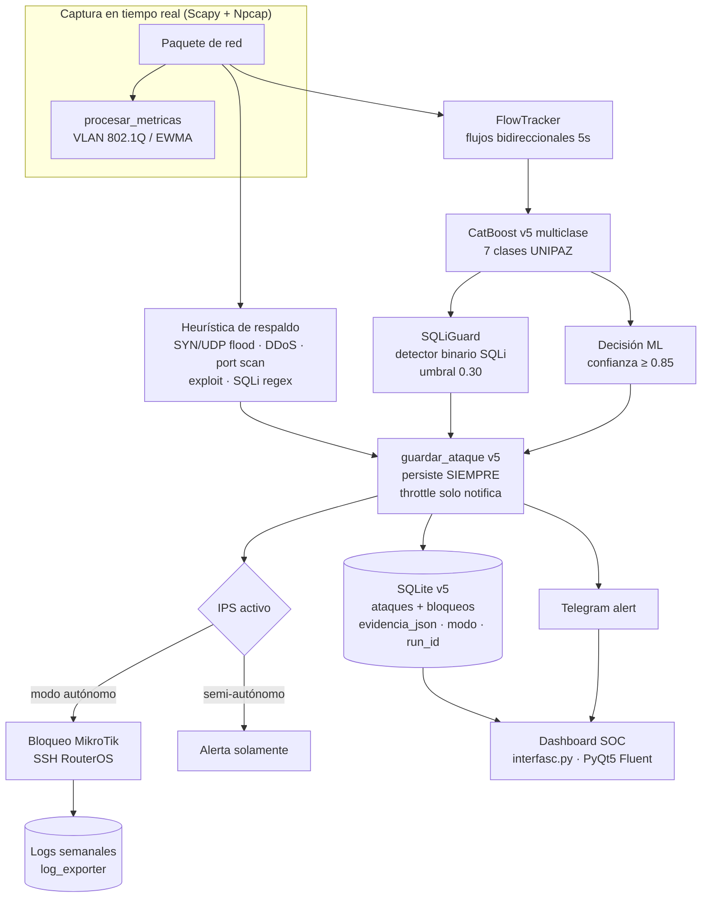

# IPS-IDBS-ML · Sistema IDS/IPS con Machine Learning (UNIPAZ)

Sistema **híbrido de Detección y Prevención de Intrusiones (IDS/IPS)** basado en Machine
Learning para la red del Instituto Universitario de la Paz (UNIPAZ). Combina **captura en
tiempo real** (Scapy + Npcap), **detección heurística**, **clasificación por CatBoost v5**,
una **capa dedicada de confirmación de Inyección SQL (SQLiGuard)** y **respuesta activa IPS**
(bloqueo en MikroTik), con dashboard SOC en PyQt5 y alertas por Telegram.

> Entorno objetivo: **Windows** (24/7), presupuesto **cero**, 100% software libre.

---

## ⚡ Características

- 🕵️ Captura pasiva de paquetes en tiempo real (modo SPAN / port mirror) con `Scapy` + `Npcap`.
- 🧠 **CatBoost v5** (multiclase, 7 clases UNIPAZ) sobre flujos bidireccionales CIC-style.
- 💉 **SQLiGuard**: detector binario dedicado de Inyección SQL entrenado con ~230 K SQLi reales
  (Zenodo 6907252) → precisión **~99.8 %** sobre test externo independiente.
- ⚖️ Heurística de respaldo con **evidencia auditable** (`n_puertos`, `n_destinos`, `ventana_s`,
  `umbral` en cada fila): escaneo de puertos por ventana deslizante `(origen, destino)`,
  barrido horizontal, SYN/UDP flood (solo SYN sin ACK), exploit y SQLi regex (solo candidatos:
  SQLiGuard es el árbitro).
- 🕯️ **Modo observación por defecto**: registra candidatos sin alertar ni bloquear (calibración
  por percentiles antes de abrir alertas).
- 🛡️ IPS activo: bloqueo automático o semi-autónomo vía SSH a MikroTik (RouterOS).
- 📊 Dashboard SOC (PyQt5 + Fluent) con eventos, tráfico, gráficos y umbrales ajustables en vivo.
- 🔔 Alertas por Telegram + logs semanales + trazabilidad SQLite (`confianza_ml`, `features_json`,
  `evidencia_json`, `run_id`, `version_motor`).

## 📦 Requisitos previos

| Requisito | Detalle |
|---|---|
| Sistema operativo | Windows 10/11 de 64 bits (objetivo de despliegue) |
| Python | 3.12 de 64 bits recomendado (mínimo 3.10) |
| Npcap | Driver de captura; se instala aparte como Administrador |
| Git + Git LFS | Solo si la carpeta conserva `.git/` (para bajar los `.pkl`) |
| GPU (opcional) | NVIDIA + CUDA para entrenamiento con `task_type='GPU'` |
| Acceso red | Puerto espejo/SPAN en el switch para capturar tráfico clonado |

## 🚀 Instalación en Windows (kit portable, paso a paso)

> [!TIP]
> **Vía recomendada.** Sin Docker, sin Python embebido y sin rutas absolutas:
> copias la carpeta, ejecutas un `.bat` como Administrador y en el próximo
> inicio de sesión se abre la GUI con el **v6 activo**. Guía completa y
> solución de problemas en [docs/PORTABILIDAD.md](./docs/PORTABILIDAD.md).

### Paso 1 — Copiar el proyecto

Copia la carpeta del proyecto a la PC nueva, por ejemplo:

```text
C:\IDS-IPS\Proyecto-IPS-IDBS-ML
```

Conserva `.git/` si quieres poder actualizar con `git pull`. Si recibiste un
ZIP sin `.git/`, comprueba que los `.pkl` son archivos reales y no punteros
LFS (el paso 5 lo verifica automáticamente).

**No copies** `.venv/`, `*.db`, `logs_ciberseguridad/*.log`, `datasets/` ni
`Dataset_Limpio/`: se crean o se descargan aparte en la PC destino.

### Paso 2 — Ejecutar el instalador como Administrador

Clic derecho en `scripts\instalar_windows.bat` → **Ejecutar como administrador**.

El instalador hace todo el trabajo:

| # | Acción |
|---|---|
| 1 | Verifica permisos de Administrador |
| 2 | Busca Python (`py -3.12` → `py -3` → `python`) |
| 3 | Crea `.venv\Scripts\python.exe` dentro del proyecto |
| 4 | Instala `requirements-windows.txt` (versiones congeladas) |
| 5 | Descarga modelos con `git lfs pull` si hay repositorio |
| 6 | Detecta Npcap y avisa si falta (**no lo instala**) |
| 7 | Crea `logs_ciberseguridad/`, `backups/` y `.env` desde la plantilla |
| 8 | Registra la tarea `IDS-Lab-V6-Activo` con disparador `ONLOGON` |
| 9 | Ejecuta la verificación de salud |

> [!IMPORTANT]
> El instalador **no lanza el motor**.

### Paso 3 — Instalar Npcap (solo si el instalador lo avisó)

1. Descarga desde **https://npcap.com/**.
2. Instálalo como Administrador (reinicia si lo pide).
3. Comprueba el servicio:

```powershell
sc query npcap
```

Npcap es un driver de kernel: no se puede instalar dentro de un contenedor ni
redistribuir sin licencia OEM, por eso el kit solo lo detecta y avisa.

### Paso 4 — Cerrar sesión y volver a entrar

No hace falta reiniciar. Al iniciar sesión, la tarea `ONLOGON` ejecuta
`scripts\lanzar_v6_lab.bat` y abre la GUI. **No cierres esa ventana**: es el
motor (minimizar sí es seguro).

Para lanzarlo manualmente sin esperar al inicio de sesión:

```powershell
scripts\lanzar_v6_lab.bat
```

### Paso 5 — Verificar que arrancó con el v6 activo

```powershell
# Chequeo de salud: no inicia el sensor
scripts\verificar_windows.bat

# Estado de la tarea
schtasks /query /tn "IDS-Lab-V6-Activo" /fo LIST /v

# Log del run
Get-Content logs_ciberseguridad\gui_lab-v6-activo.log -Tail 20
```

La línea que confirma el laboratorio es:

```text
[OK] Modelos v6 cargados (sombra=NO): CatBoost v6 (7 umbrales por clase) + detector de payload
```

Si aparece `[!] No se pudieron cargar los modelos v6`, los `.pkl` son punteros
LFS: ejecuta `git lfs install --local` y `git lfs pull`.

### Paso 6 — Confirmar la medición pasiva

Con las clases activas, toda predicción sigue guardándose en `ml_candidatos`:

```powershell
.venv\Scripts\python.exe -c "import sqlite3; c=sqlite3.connect('intrusiones_v5.db'); [print(r) for r in c.execute(\"SELECT clase_predicha, decision, COUNT(*) FROM ml_candidatos WHERE run_id='lab-v6-activo' GROUP BY 1,2\")]"
```

### Actualizar / desinstalar

```powershell
# Actualizar (git pull + git lfs pull + dependencias; no lanza el motor)
scripts\actualizar_windows.bat

# Desinstalar el arranque automático
schtasks /delete /tn "IDS-Lab-V6-Activo" /f
rmdir /s /q .venv
```

> [!CAUTION]
> Si mueves la carpeta después de instalar, `schtasks` sigue apuntando a la
> ruta antigua. Vuelve a ejecutar `scripts\instalar_windows.bat` como
> Administrador para re-registrar la tarea con la nueva ruta.

### Instalación manual (alternativa para desarrollo)

```powershell
# 1. Clonar (los modelos vienen por Git LFS)
git clone https://github.com/K-ev1004/Proyecto-IPS-IDBS-ML.git
cd Proyecto-IPS-IDBS-ML

# 2. Entorno virtual y dependencias
py -3.12 -m venv .venv
.\.venv\Scripts\python.exe -m pip install -r requirements-windows.txt

# 3. Modelos y driver
git lfs install --local
git lfs pull
sc query npcap
```

## ⚙️ Configuración (variables de entorno)

| Variable | Uso | Obligatoria |
|---|---|---|
El lanzador `scripts\lanzar_v6_lab.bat` carga `.env` de la raíz antes de arrancar
(plantilla: [`.env.example`](./.env.example)). Formato: `CLAVE=VALOR`, sin comillas
y sin `export`. Las líneas que empiezan con `#` se ignoran.

| Variable | Uso | Obligatoria |
|---|---|---|
| `IDS_ML_V6` | `1` carga CatBoost v6 + detector de payload | No (el lanzador lab la fija en `1`) |
| `IDS_ML_SOMBRA` | `1`: todo a `ml_candidatos`; `0`: clases activas | No (el lanzador lab la fija en `0`) |
| `IDS_ML_ALERTAS` | `0`: el v5 queda en instrumentación | No |
| `IDS_IPS_AUTONOMO` | `1`: bloqueo autónomo vía MikroTik; `0` (defecto): semi-autónomo | No |
| `IDS_RUN_ID` | Etiqueta de la corrida (lab: `lab-v6-activo`) | No |
| `IDS_AUTO_INICIAR` | `1`: arranca la captura al abrir la GUI | No |
| `LOG_FOLDER` | Carpeta de logs (def. `D:\logs_ciberseguridad` si existe esa unidad; si no, `logs_ciberseguridad/`) | No |
| `IDS_IFACE` | Nombre exacto de la NIC del SPAN; vacío = autodetección | No |
| `IDS_TELEGRAM_TOKEN` / `IDS_TELEGRAM_CHAT_IDS` | Token y chats de Telegram (antes `TELEGRAM_BOT_TOKEN` / `TELEGRAM_CHAT_IDS`, aún aceptados) | Solo si se usan alertas |
| `MIKROTIK_IP` / `MIKROTIK_USER` / `MIKROTIK_PASS` | Credenciales del router para bloqueo IPS | Solo modo autónomo |
| `IDS_MODO_OBSERVACION` | `1` (defecto): persiste candidatos sin alertar ni bloquear. `0`: alerta (y bloquea si aplica) | No |
| `IDS_DB_PATH` | Ruta de la base SQLite (def. `intrusiones_v5.db`) | No |
| `IDS_SCAN_THRESHOLD` / `IDS_SCAN_THRESHOLD_INT` | Umbral de escaneo externo/interno (puertos distintos a un destino) | No |
| `IDS_SCAN_WINDOW` / `IDS_SCAN_COOLDOWN` / `IDS_SCAN_MIN_DST` | Ventana (s), enfriamiento por pareja (s) y destinos mínimos del barrido horizontal | No |
| `IDS_HOSTS_GESTION` | IPs de gestión/monitorización exentas del detector de exploit (def. `172.10.0.57,172.10.0.59` — TFTP broadcast; ver [Runbook C3](./docs/RUNBOOK_C3.md)) | No |

> [!NOTE]
> `telegram_alert.py` ya lee el token y los chats desde entorno (con un valor
> de desarrollo heredado como fallback para no romper la máquina actual).
> **En una PC nueva define `IDS_TELEGRAM_*` en `.env` y rota el token** antes de
> distribuir la carpeta. Las credenciales MikroTik se leen de `MIKROTIK_*` o de
> un perfil en `config/` (nunca del código). `.env` está ignorado por Git.

## 🧭 Comandos principales

```powershell
# GUI (recomendado)
python interfasc.py

# Motor IDS/IPS standalone (10 s de captura de prueba)
python ids.py

# Reconstruir dataset global v5 (CIC-IDS2017 + 2018 + DDoS2019)
python generador_dataset_global.py

# Entrenar modelo multiclase v5 (GPU) → Modelos_Entrenados/*v5*
python CEREBRO_V5.py

# Entrenar SQLiGuard (detector binario SQLi)
python entrenar_sqli_guard.py

# Batería de pruebas masivas (datasets sintéticos + trazabilidad)
python test_masivo.py

# Pruebas unitarias del motor (paquetes sintéticos, sin red)
.\venv\Scripts\python.exe -m pytest tests/ -v

# Backup diario comprimido + purga de eventos > 90 días
python scripts/backup_bd.py

# Calibrar umbrales de escaneo tras la ventana de observación
python scripts/calibrar_escaneo.py --horas 72

# Analizar el post-mortem de la v1 (y generar copia anonimizada)
python scripts/analizar_produccion.py --anonimizar evidencia/corpus_anon.csv

# Exportar logs semanales
python log_exporter.py
```

## 🏗️ Arquitectura



### Flujo de decisión ML (v5 + SQLiGuard)

1. El flujo completo genera features CIC-style → `pipeline_catboost_v5.pkl` predice la clase.
2. **SQLiGuard** (features NetFlow) confirma o descarta `Inyeccion_SQL`:
   - Si `P(SQLi) ≥ UMBRAL_SQLI_GUARD (0.30)` → se registra como `Inyeccion_SQL` (alta precisión).
   - Si v5 decía SQLi pero SQLiGuard no confirma → no se loguea (reduce falsos positivos).
3. Para el resto de clases se exige `confianza_ml ≥ UMBRAL_ML (0.85)` para loguear y bloquear.

## 📁 Estructura del repositorio

```
.
├── interfasc.py                 # GUI (dashboard SOC PyQt5 Fluent)
├── ids.py                       # Motor principal IDS/IPS (captura, ML, respuesta activa)
├── flujos_red.py                # FlowTracker: flujos bidireccionales y features
├── mikrotik_api.py              # Bloqueo IPS vía SSH a RouterOS
├── telegram_alert.py            # Alertas Telegram
├── log_exporter.py              # Logs semanales y registro de bloqueos
├── generador_dataset_global.py  # Pipeline de datos (CIC 2017+2018+2019) → v5
├── CEREBRO_V5.py                # Entrenamiento CatBoost v5
├── entrenar_sqli_guard.py       # Entrenamiento SQLiGuard
├── test_masivo.py               # Batería de pruebas end-to-end
├── tests/                       # Pruebas unitarias del motor (scapy sintético)
├── scripts/                     # Kit portable: instalar/actualizar/verificar Windows
│   ├── instalar_windows.bat     #   Instalador de un clic (como Administrador)
│   ├── actualizar_windows.bat   #   git pull + LFS + dependencias
│   ├── verificar_windows.bat    #   Chequeo de salud (no inicia el sensor)
│   ├── verificar_entorno.py     #   Comprobación Python de dependencias/modelos
│   ├── lanzar_v6_lab.bat        #   Lanzador del laboratorio v6 (rutas relativas)
│   └── instalar_tarea_v6_lab.bat#   Registra IDS-Lab-V6-Activo (ONLOGON)
├── evidencia/                   # Exportaciones, corpus anonimizado y hashes
├── requirements.txt             # Dependencias base (desarrollo)
├── requirements-windows.txt     # Dependencias pinnadas del kit portable
├── .env.example                 # Plantilla de configuración sin secretos
├── .gitattributes               # Git LFS para *.pkl
├── scripts/legacy/              # Scripts históricos v2/v3 (conservados como evidencia)
├── Modelos_Entrenados/          # Artefactos v5 + SQLiGuard (Git LFS)
├── datasets/                    # Datasets crudos (ignorados en git)
├── Dataset_Limpio/              # Dataset global v5 (ignorado)
├── docs/                        # → Documentación (este proyecto)
│   ├── academico/               # Tesis, anteproyecto e imágenes (docx/pdf/xlsx/tex)
│   ├── adr/                     # Registros de decisiones (ADRs)
│   ├── guias/                   # Guías de instalación, uso y entrenamiento
│   ├── ml/                      # Análisis ML (algunos históricos)
│   ├── lab/                     # Laboratorio virtual: evidencia T5 (CHR real)
│   ├── red/                     # Arquitectura de red UNIPAZ
│   ├── tesis/                   # Capítulos y anteproyecto (académico)
│   └── CHANGELOG.md             # Historial de cambios del sistema
└── (LICENSE)                    # Pendiente de definir licencia
```

## 📚 Documentación

| Sección | Contenido |
|---|---|
| [Portabilidad Windows](./docs/PORTABILIDAD.md) | Kit de un clic: copiar carpeta → instalar → arrancar → verificar → desinstalar |
| [Guias](./docs/guias/) | Instalación, uso de la GUI y entrenamiento de modelos |
| [ADRs](./docs/adr/) | Decisiones de arquitectura (v5, SQLiGuard, Git LFS) |
| [ML](./docs/ml/) | Análisis técnico y viabilidad de datasets |
| [Laboratorio](./docs/lab/) | Laboratorio virtual (RouterOS CHR), T5 y [demo en vivo](./docs/lab/demo-bloqueo.md) |
| [Plan de lanzamiento v5](./docs/PLAN_LANZAMIENTO_V5.md) | Post-mortem de la v1, esquema v5, fases y criterios de aceptación |
| [Runbook C3](./docs/RUNBOOK_C3.md) | Dejar el servidor 72 h en observación: tareas programadas, backup y calibración |
| [Red UNIPAZ](./docs/red/) | Topología de red y plan de despliegue |
| [Tesis](./docs/tesis/) | Anteproyecto y capítulos académicos |
| [CHANGELOG](./docs/CHANGELOG.md) | Historial de cambios verificados |

## ✅ Estado del proyecto

- Modelo **v5** en producción: acc 0.8641 · F1-macro 0.7442 · Kappa 0.8138.
- **SQLiGuard**: precisión 99.85 % · recall 75 % (umbral 0.30) en test externo (D2).
- Umbrales unificados: logueo y bloqueo ML con `UMBRAL_ML = 0.85`.
- **Motor v5 (2026-10)**: esquema con evidencia completa, detector de escaneo por ventana
  `(origen, destino)`, modo observación por defecto; lanzamiento de nueva producción en curso
  (ver [plan de lanzamiento](./docs/PLAN_LANZAMIENTO_V5.md)).
- **Laboratorio v6 (rama `ml-v6`)**: `IDS_ML_V6=1` + `IDS_ML_SOMBRA=0` + `IDS_RUN_ID=lab-v6-activo`, bloqueo OFF y medición pasiva conservada en `ml_candidatos`. Arranque automático con `IDS-Lab-V6-Activo` (`ONLOGON`); ver [ML v6](./docs/ML_V6_AVANCE.md).
- **Portabilidad Windows**: kit en carpeta con `scripts\instalar_windows.bat`, `.venv` local y rutas relativas; ver [docs/PORTABILIDAD.md](./docs/PORTABILIDAD.md).
- Ver `docs/CHANGELOG.md` para el detalle completo.

---

*Proyecto académico · Instituto Universitario de la Paz (UNIPAZ) · Ingeniería de Sistemas*
